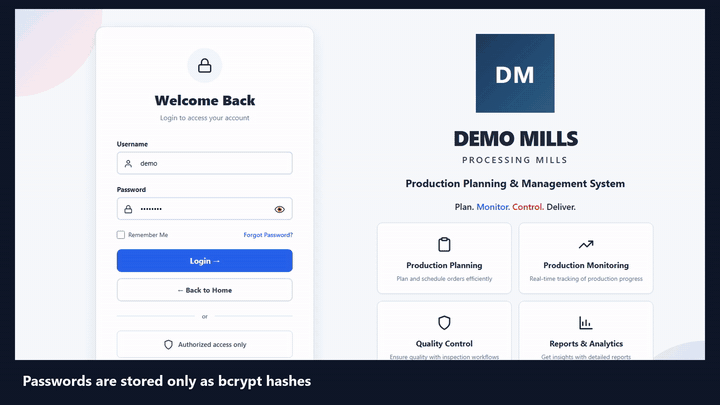
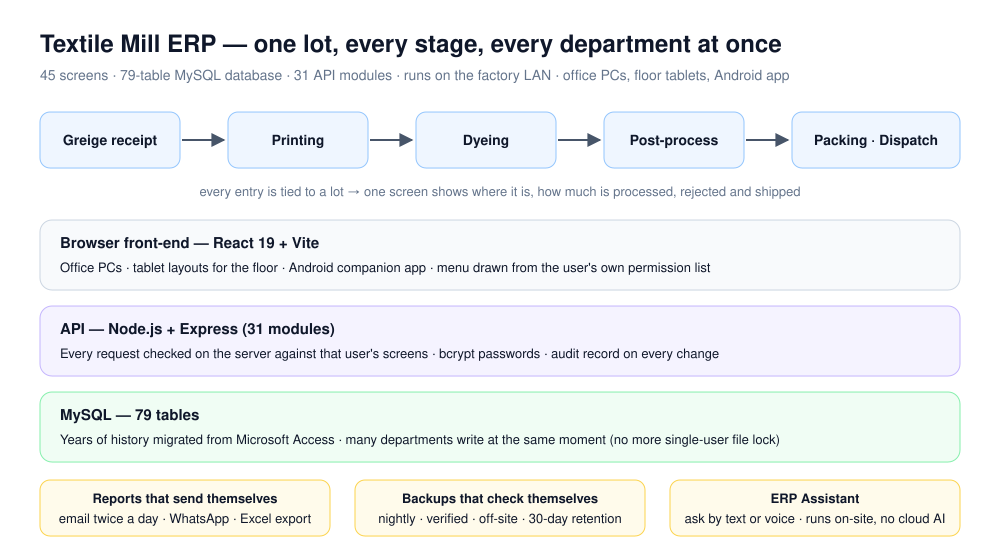
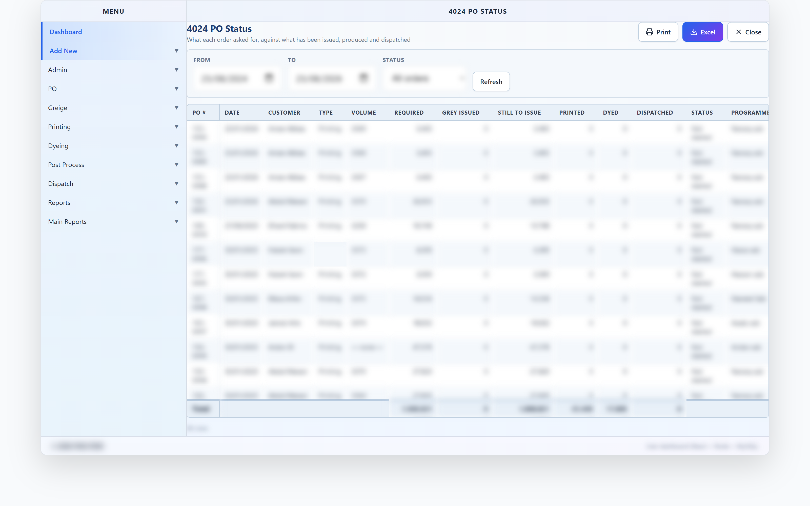
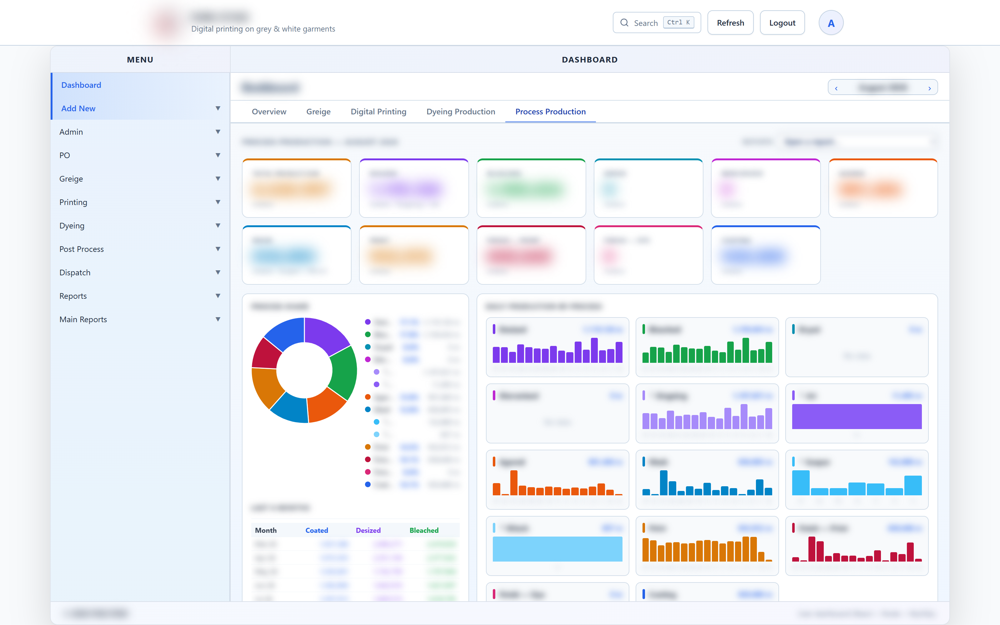
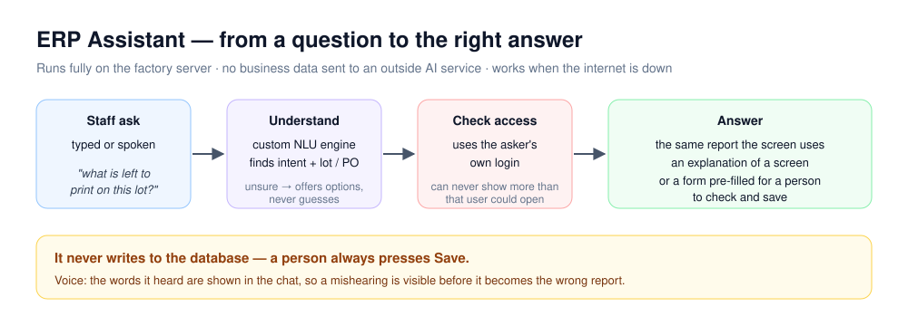

# Textile Mill ERP

A complete production-management system that a textile processing mill uses every day. It follows fabric from greige receipt through printing, dyeing and post-processing to packing and dispatch, with lot-level traceability. It replaced paper, spreadsheets and a single-user Microsoft Access database.

**I built and maintain all of it alone** — 45 screens, a 79-table MySQL database, 31 API modules, tablet layouts for the production floor and an Android companion app.

> **This repository is a showcase.** The source code belongs to the client and stays private. Everything here is a demo video, a diagram, or a screenshot with every value blurred before capture.

[Portfolio](https://abdurrehman629.github.io) · [All case studies](https://github.com/ABDURREHMAN629/case-studies) · [LinkedIn](https://www.linkedin.com/in/abdur-rehman-ar03247440629) · [Email](mailto:gabdurrehman493@gmail.com)

---

## Watch it work

▶ **[Watch the full 2-minute walkthrough](https://abdurrehman629.github.io/projects/textile-mill-erp/)** · [download MP4](media/textile-mill-erp-walkthrough.mp4). Recorded on a demo database, so every name and number is made up.

## The problem

All of the mill's records lived in one Microsoft Access file. Access locks the file, so **only one person could enter data at a time**. Greige, printing, dyeing, post-process and dispatch all work at once, so staff waited for the database or wrote on paper and typed it in later. Management was always looking at yesterday's figures.

- Nobody could see where a lot was without asking several people
- Rows could be changed or deleted with no record of who did it
- End-of-shift reports were compiled by hand in Excel
- One corrupted file would have lost years of history

## What I built

A web application on the factory's own network. Staff use it in a browser on office PCs and floor tablets, so nothing has to be installed on each machine. Every department enters its own data **at the same time** into one MySQL database, and every entry is tied to a lot.

| Area | What it covers |
|---|---|
| Greige | receiving, issuance, returns, rejection, lot transfer |
| Production | printing and dyeing entries with machine and operator |
| Post-process | every stage from singeing to finishing and calendering |
| Dispatch | packing, gate passes, dispatch and shortage tracking |
| Reports | 14 live reports with one-click Excel export |
| Admin | user accounts, per-screen access for 20+ roles, notifications |

## Screenshots

Captured from the real system. Every value is blurred before the shutter opens — the redaction blurs **all** text by default and shows only menus, headings and column labels.

| Dashboard | Purchase-order status |
|---|---|
|  |  |
| **PO entry** | **Production charts** |
|  |  |

## Harder problems I solved

### Moving years of history out of Microsoft Access
A system that started empty would have thrown the mill's history away. I wrote migration tooling that moved every record from a 60-table Access database into MySQL: table names with spaces quoted for both engines, a hand-written 39-table insert order, half-typed dates turned into empty values instead of failing the row, failed batches retried row by row with the broken row logged. It can be **re-run safely** and always lands in the same clean state, and it never touches user accounts.

### Reports that send themselves
A scheduled job emails a production summary twice a day — evening for the day just worked, next midday for the settled figures. It runs the same queries as the dashboard, so the email and the screen always agree. WhatsApp is a second channel.

### Backups that check themselves
Every night the database is copied without locking anyone out, then compressed, **verified**, uploaded off-site and kept for 30 days. The verification matters: a backup cut short by a dropped connection looks fine until the day you need it.

### An answer for every disputed number
Every change writes an audit record — which values changed, the old and new figure, who changed them and when. The application writes it, so the change is tied to a real person, not a shared database login.

### Built-in AI assistant
Staff ask questions in plain words, typed or spoken, and get the same figure the report shows. It uses the asker's own permissions, never writes data itself, and runs fully on the factory server, so business data never leaves the building.

## Results

- ✅ Every department enters data live — no more waiting for one file
- ✅ Any lot traced from fabric receipt to dispatch in one click
- ✅ Management reports arrive automatically, twice a day
- ✅ A disputed quantity always has a definite answer
- ✅ Years of old records were kept, not thrown away

## Technology

`React 19` · `Vite` · `Node.js` · `Express` · `MySQL` · `SheetJS` · `node-cron` · `Nodemailer` · `rclone` · `Android`

---

**Need a system like this for your business?** [Email me](mailto:gabdurrehman493@gmail.com) or message me on [LinkedIn](https://www.linkedin.com/in/abdur-rehman-ar03247440629). I'm happy to walk through the architecture on a call.
